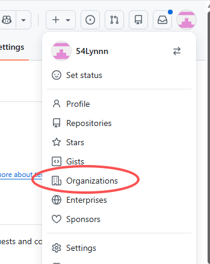
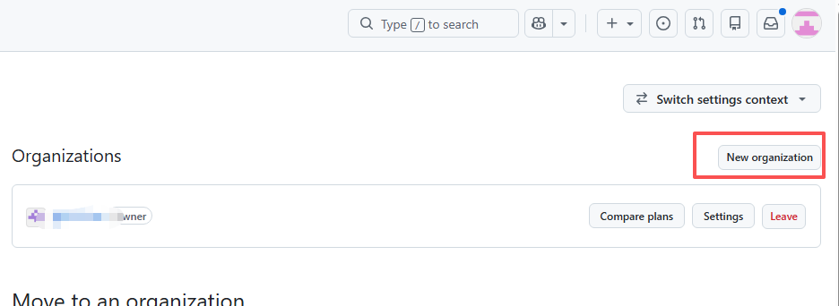
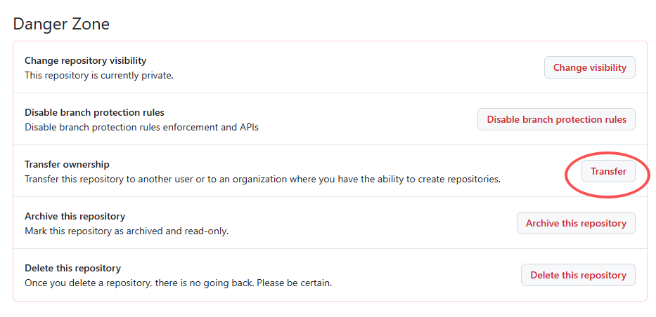
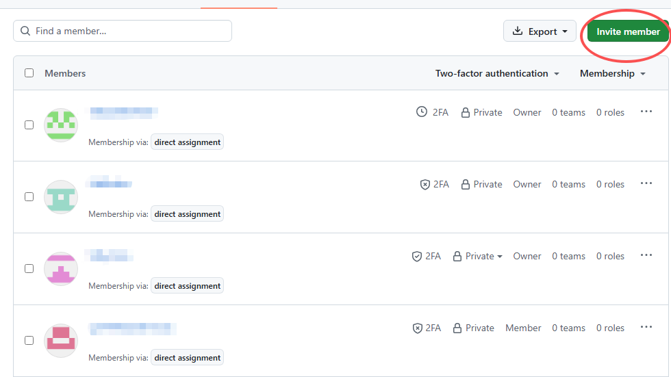

# 📖 Guide · AI 编程实践与前沿工作流攻略专栏

欢迎来到本专栏！这里记录并沉淀我们在 AI 编程与大模型 Agent 探索中的一线硬核实战经验。

* 💬 **[点击进入 Discussions 专栏参与讨论与互动](https://github.com/54Lynnn/Guide/discussions)**
* 📌 **[本篇专栏直达链接：Hark.com 多账号无缝接力实战](https://github.com/54Lynnn/Guide/discussions/1)**

---

# Hark.com 多账号无缝接力：薅尽顶级 Opus 5.5 算力推进 GitHub 项目实战

## 🚀 核心玩法与算力优势

[Hark.com](https://hark.com/) 是一款个人云端 AI Agent 编程平台，目前注册门槛极低，每个账号每天均提供大几千万的免费 Token 额度，且直接支持顶级的 **Claude Opus 5.5** 模型！

单号每天的额度已足够庞大，但如果项目较复杂、需要全天候不间断迭代，可以通过「GitHub 组织多账号协作」实现**多号接力**：一个号的额度蹬完，立刻换下一个小号继续推进同一个项目仓库，无缝接力！

---

## 🛠️ 第一步：GitHub 创建独立组织（Organization）

> **为什么建组织**：个人仓库只能绑定一个 GitHub 账号授权，而将项目移入 GitHub Organization（组织）后，可以无限制添加小号并赋予完整所有权。

1. 在浏览器中登录你的 GitHub 主号，点击右上角个人头像，在下拉菜单中点击 **「Organizations」**。
2. 进入组织管理页（[https://github.com/settings/organizations](https://github.com/settings/organizations)），点击右上角的 **「New organization」** 按钮，按页面指引创建一个免费的 GitHub 组织（选择 Free 方案即可，不需要付费）。

---

## 📦 第二步：将个人项目移入（Transfer）新建的组织

1. 打开你想让 Agent 帮忙开发或重构的 GitHub 项目仓库页面。
2. 点击仓库顶部的 **「Settings」**（仓库设置）。
3. 滚到设置页面的最底部，在红色的 **「Danger Zone」**（危险区）中，找到 **「Transfer ownership」**（转移所有权）。
4. 点击「Transfer」，在弹出框中输入你刚才新建的组织名称确认转移（如果是私有仓库注意确认保持 Private 私有）。

---

## 👥 第三步：在组织中邀请小号并全部设为 Owner

1. 进入你刚才创建的 GitHub 组织主页。
2. 点击顶部的 **「People」**（成员管理）标签页。
3. 点击右上角的绿色按钮 **「Invite member」**，搜索并邀请你的 GitHub 小号。
4. 在角色权限分配中，将所有参与接力的小号**全部设置为「Owner」（所有者）**权限。

> **提示**：设为 Owner 权限后，所有小号都具备对该仓库直接提交代码、创建分支和推送远端的最高读写权限。

---

## ⚡ 第四步：进入 Hark.com 开始多号无缝接力协作

1. 打开 [Hark.com](https://hark.com/)，用你的 GitHub 小号登录授权。
2. 把组织内的项目仓库链接发给 Hark，Agent 即可直接在组织仓库内检出代码并开始工作。
3. **核心关键技巧**：在向 Hark 下发任务指令时，要求它 **「代码修改必须密集提交并及时推送到远端 Git（git push）」**。这样一旦当前小号的单日额度用尽，最新进度也已经稳稳同步在了 GitHub 组织仓库中！
4. **无缝接力**：当一个小号额度耗尽时，无需等待第二天——注册并切换下一个 Hark 新号，同样把该组织仓库链接扔给它，Agent 自动基于最新的代码进度无缝接力继续迭代！

> 💡 **总结**：通过这个 GitHub 组织仓库中转枢纽，多个 Hark 账号的千万级 Token 额度就被彻底串联成了一条不间断的无限算力流水线！
